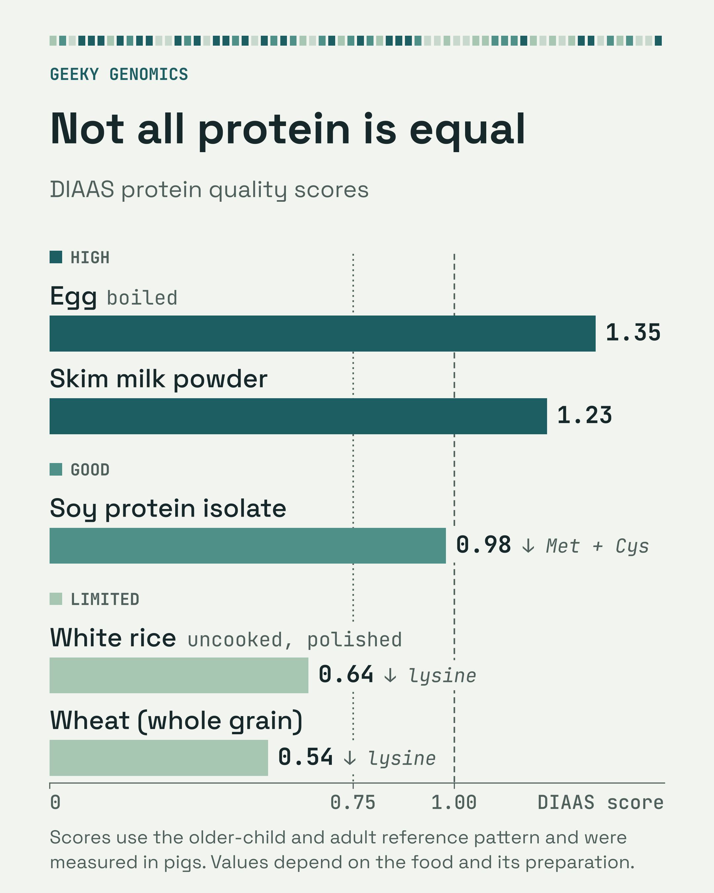
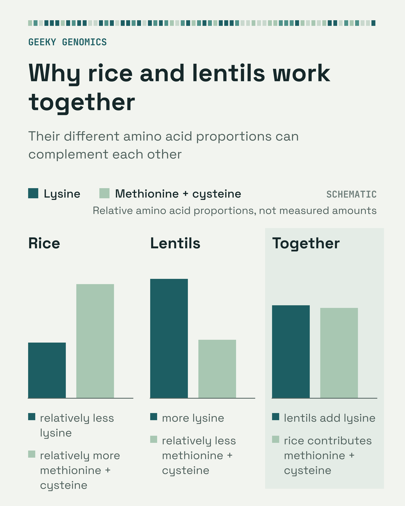
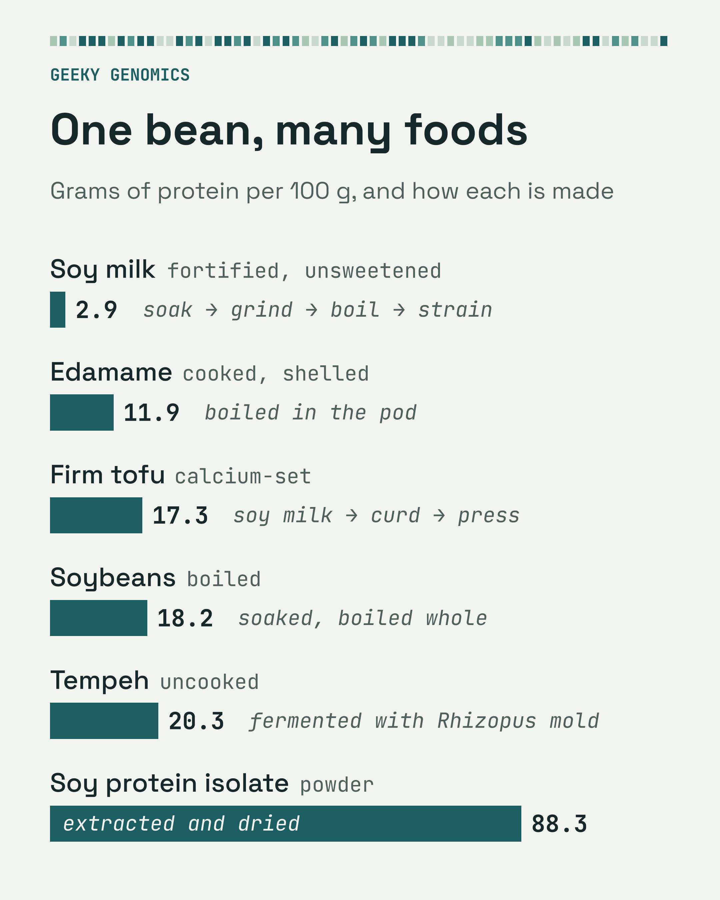
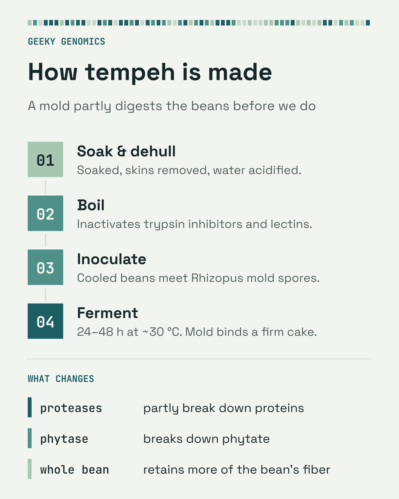

# The protein on the label is not always the protein you get
## Why plant protein is harder to use, and how cooking and fermenting fix a lot of it
**Published on:** Geeky Genomics, *Breaking down DNA, biology and aging!*

---

> **[SUBSTACK POLL — insert natively before publishing]**
> *"Where do you currently get most of your protein?"*
> - Mostly meat and fish
> - Mostly eggs and dairy
> - Mostly plants
> - A mix of everything
>
> *(Add this as a native Substack poll at the top of the post)*

---

I studied nutrition as an undergrad, and we spent a whole semester learning about the biochemical pathways micronutrients are involved in. I kept a little notebook tracking each one, for example vitamin D and calcium absorption, B12 and what a deficiency does to nerve conduction, and which minerals act as cofactors for which enzyme reactions. I was so curious and excited by how much of human physiology just comes down to what we eat.

I was also always fascinated by how little of each micronutrient we need, often just micrograms a day, while protein is needed in grams, a whole different order of magnitude. Nothing works in isolation. Proteins cannot be made or function properly without micronutrients, but at the end of the day we need A LOT of protein just to function. The enzymes that B vitamins activate are proteins, and so are the carriers that move minerals into cells.

Part of why we need so much is that the body never stops rebuilding itself. Every day it breaks down and remakes large amounts of its own protein as muscle fibers repair, enzymes turn over, and cells die and are replaced. It recycles most of the amino acids released in this process, but some are lost to other metabolic uses, and the shortfall has to come from food. The body can make eleven of the twenty amino acids it needs from other molecules, but it cannot make enough of the remaining nine, so those must come from food. They are called essential amino acids.[^young-pellett]

That is why the source of protein matters as much as the amount. A short supply of one essential amino acid can limit how much protein the body builds, even when the others are plentiful. What counts is the combined supply from the diet and from the amino acids already circulating in the body. An amino acid that is in short supply in one food can come from another food you eat.

[^young-pellett]: Young, V. R., & Pellett, P. L. (1994). Plant proteins in relation to human protein and amino acid nutrition. *American Journal of Clinical Nutrition*, 59(5 Suppl), 1203S–1212S. https://doi.org/10.1093/ajcn/59.5.1203S

Everything alive runs on protein, from tiny microbes to giant elephants, so in theory almost anything you eat contains some. Maybe that is a cheesy way to put it, but I am fascinated by how widely people assume you must eat meat to get enough protein. That assumption is one of the threads I want to keep pulling on in this post. A lot of myths about plant protein persist partly because the science of plant nutrition really is a little trickier.

The general consensus is that if you eat a decent amount of meat, with a side of eggs, you are good to go, while plants get a rough reputation when it comes to protein. But plants are not low-protein foods, even if a salad plate gives that impression. A cup of cooked lentils contains roughly 18 grams of protein, more than two large eggs, and tofu, tempeh, chickpeas, and whole grains each offer substantial amounts. How much protein a plant food contains matters, but the gram count is only the starting point. What also matters is how much of that protein the body digests, and whether its essential amino acids come in the right proportions.

Leaves are not where this story happens. Rubisco, the enzyme plants use to capture carbon dioxide, is the most abundant protein on Earth,[^rubisco-baron] and purified Rubisco has a promising amino acid profile, but leaves are mostly water. Raw spinach has under three grams of protein per hundred grams. Nearly all the plant protein people eat comes from seeds, meaning lentils, chickpeas, beans, tofu, tempeh, rice, oats, and wheat, foods that have been staples across many agricultural societies.

This post covers what makes seed protein harder to use, how cooking, fermentation, and food combinations change the picture, and why the amino acid pattern that makes plant protein look weaker on paper raises an interesting question about aging.

[^rubisco-baron]: Bar-On, Y. M., & Milo, R. (2019). The global mass and average rate of rubisco. *Proceedings of the National Academy of Sciences*, 116(10), 4738–4743. https://doi.org/10.1073/pnas.1816654116

---

## What the grams on the label don't tell you

The grams of protein on a label are generally estimated from the food's nitrogen content or from food-composition tables. They tell you how much protein is present by weight. They do not tell you how much of it you digest, or whether its essential amino acids come in the proportions the body needs.

Those are two separate questions, and it helps to keep them apart. The first is digestibility, how much of each amino acid is absorbed before food leaves the small intestine. The second is balance, whether the digested amino acids match the body's requirements or run short in one of them. Most animal proteins do well on both. Many plant proteins do well on one and less well on the other, and preparation can change both.

Nutrition scientists combine the two into a single number called DIAAS, the Digestible Indispensable Amino Acid Score, introduced by the Food and Agriculture Organization in 2013. ("Indispensable" is the FAO's word for the same nine essential amino acids.) Researchers estimate how digestible each essential amino acid is from how much remains at the end of the small intestine, the last point where amino acids are absorbed. They then compare each digested amino acid against a reference pattern of human requirements. The amino acid that falls furthest short, called the limiting amino acid, sets the score.

A score of 1.0 means each gram of protein supplies at least the reference amount of every essential amino acid after digestion. A score below 1.0 means a gram of that protein supplies less of its limiting amino acid than the reference. It does not mean only that fraction of the protein was absorbed, and it does not tell you whether your whole diet supplies enough, because other foods can fill the gap.

You will not find DIAAS on grocery labels. In the United States, regulations still use an older score called PDCAAS when calculating the percent Daily Value for protein. PDCAAS estimated digestibility from stool, which can misrepresent amino acid digestibility because bacteria in the colon break down and alter amino acids, and it capped every score at 1.0.[^diaas-mathai] For now DIAAS lives mostly in research papers, so the values in this post come from published studies.

*Scores use the FAO reference pattern for older children, adolescents, and adults. Measurements were made in pigs, and values depend on the food and its preparation. Boiled whole egg 1.35,[^fanelli-egg] skim milk powder 1.23, soy protein isolate 0.98, and whole-grain wheat 0.54,[^diaas-mathai] and uncooked polished white rice 0.64.[^diaas-cervantes] "Met + Cys" means methionine plus cysteine, the sulfur amino acids.*

Animal sources sit above 1.0, cereals fall well below it, and soy sits close to the line. Three features of plant seeds explain most of that gap.

[^fanelli-egg]: Fanelli, N. S., Martins, J. C. F. R., & Stein, H. H. (2024). The digestible indispensable amino acid score (DIAAS) in eggs and egg-containing breakfast meals is greater than in toast breads or hash browns served without eggs. *Journal of Nutritional Science*, 13, e68. https://doi.org/10.1017/jns.2024.71
[^diaas-mathai]: Mathai, J. K., Liu, Y., & Stein, H. H. (2017). Values for digestible indispensable amino acid scores (DIAAS) for some dairy and plant proteins may better describe protein quality than values calculated using the concept for protein digestibility-corrected amino acid scores (PDCAAS). *British Journal of Nutrition*, 117(4), 490–499. https://doi.org/10.1017/S0007114517000125
[^diaas-cervantes]: Cervantes-Pahm, S. K., Liu, Y., & Stein, H. H. (2014). Digestible indispensable amino acid score and digestible amino acids in eight cereal grains. *British Journal of Nutrition*, 111(9), 1663–1672. https://doi.org/10.1017/S0007114513004273

---

## Three things standing in the way

### 1. Right amino acids, wrong proportions

Most plant proteins contain all nine essential amino acids. The issue is proportion. Most seed proteins have one that runs short relative to human needs, and that limiting amino acid caps the score.

Grains are often limited by **lysine**, an amino acid the body uses for muscle repair and collagen, and wheat is often strongly limited.[^diaas-cervantes] Legumes like lentils and chickpeas run the other way. They have plenty of lysine but are relatively low in the sulfur amino acids, **methionine** and cysteine. Methionine is the starting point for many of the body's chemical tagging reactions, including ones that switch genes on and off.

Corn is short in both lysine and **tryptophan**, and the body uses tryptophan to make the B vitamin niacin. When people in the American South and parts of Europe lived on little but corn in the late 1800s and early 1900s, many developed pellagra, a niacin deficiency marked by dermatitis, diarrhea, and dementia.[^pellagra] In Mesoamerica, where corn was domesticated, cooking it with lime (a process called nixtamalization) releases its bound niacin, and together with a varied diet that included beans, it helped protect people who ate corn every day.

This is why the traditional pairing of rice and lentils (and grains with legumes more broadly) works. Lentils supply the lysine rice lacks, and rice supplies some of the sulfur amino acids lentils lack, so the combination is better balanced than either food alone. How much better depends on the proportions. I love this fact. The two foods do not even need to be on the same plate. Eating complementary proteins over the course of the day works, because adequate total intake and variety matter more than precise matching within a meal.[^young-pellett]

*Schematic, not measured amounts. Both foods contain all nine essential amino acids, and the benefit of pairing them depends on their proportions.*

[^pellagra]: Hegyi, J., Schwartz, R. A., & Hegyi, V. (2004). Pellagra: dermatitis, dementia, and diarrhea. *International Journal of Dermatology*, 43(1), 1–5. https://doi.org/10.1111/j.1365-4632.2004.01959.x. For the US history: Rajakumar, K. (2000). Pellagra in the United States: a historical perspective. *Southern Medical Journal*, 93(3), 272–277. PMID 10728513.

> **[STYLED TEXT BOX — create in Canva or Substack formatting:]**
> **Classic Protein Pairings That Work**
> 🌾 Rice (low lysine) + 🫘 Lentils or beans (low methionine and cysteine)
> 🌽 Corn (low lysine and tryptophan) + Beans
> 🍞 Wheat bread (low lysine) + Hummus
> *Each pairing fills the other food's gap. The exact benefit depends on how much of each you eat.*

### 2. Locked inside cell walls

Every plant cell is surrounded by a rigid wall made mostly of **cellulose**, a carbohydrate that human digestive enzymes cannot break down. Even when a plant food is protein-rich, some of that protein sits inside cells whose walls the gut cannot open on its own.

Cooking softens plant tissues and inactivates some of the antinutrients described below, while chewing, mashing, and grinding expose more of the cell contents to digestive enzymes. In one pig experiment that used raw kidney-bean meal as the only protein source, digestibility of protein nitrogen at the end of the small intestine was near zero or even negative, and heat treatment raised it substantially.[^raw-beans] Pigs are a standard model for human digestion, and even cooked pulses vary in pigs, with essential amino acid digestibility ranging from about 73% for kidney beans to 87% for broad beans.[^han-pulses]

Processing can push digestibility higher still. When tofu, soy milk, and seitan were tested in minipigs, their proteins were 92 to 97% digestible, close to animal protein.[^reynaud] The physical structure of whole plant foods remains one reason they are digested less completely than animal proteins,[^cell-wall-review] and it is also why preparation makes such a difference.

[^raw-beans]: Rubio, L. A., et al. (2005). Ileal digestibility of raw and autoclaved kidney-bean (*Phaseolus vulgaris*) seed meals in cannulated pigs. *Animal Science*, 81(1), 125–133. https://doi.org/10.1079/ASC41740125
[^han-pulses]: Han, F., Moughan, P. J., Li, J., & Pang, S. (2020). Digestible Indispensable Amino Acid Scores (DIAAS) of six cooked Chinese pulses. *Nutrients*, 12(12), 3831. https://doi.org/10.3390/nu12123831
[^reynaud]: Reynaud, Y., Buffière, C., Cohade, B., Vauris, M., Liebermann, K., Hafnaoui, N., et al. (2021). True ileal amino acid digestibility and digestible indispensable amino acid scores (DIAASs) of plant-based protein foods. *Food Chemistry*, 338, 128020. https://doi.org/10.1016/j.foodchem.2020.128020
[^cell-wall-review]: Ajomiwe, N., Boland, M., Phongthai, S., Bagiyal, M., Singh, J., & Kaur, L. (2024). Protein Nutrition: Understanding Structure, Digestibility, and Bioavailability for Optimal Health. *Foods*, 13(11), 1771. https://doi.org/10.3390/foods13111771

### 3. The seed fights back

The third layer is chemical and comes from the seed's own defenses. Seeds are a plant's offspring, and they evolved compounds that discourage animals and insects from eating and digesting them, along with storage molecules that hold nutrients for the seedling. These fall into two groups that are worth keeping apart, because one affects protein and the other mostly affects minerals.

Some interfere with protein digestion. **Trypsin inhibitors** in legumes block trypsin, one of the main enzymes the pancreas makes to break down protein, and **tannins** can bind proteins directly. **Lectins**, concentrated in beans, can irritate the gut lining when beans are undercooked. Heat inactivates most trypsin inhibitors and lectins, which is a big reason cooked beans are so different from raw ones.

Others mainly bind minerals. **Phytate** is the seed's phosphorus store and is abundant in grains and legumes, and in the gut it binds iron, zinc, and calcium, reducing how much the body absorbs from that meal. **Oxalate**, found in foods like spinach, binds calcium in particular. The best-known nutritional effects of these compounds concern mineral absorption, though phytate can also interact with proteins and reduce their digestibility.[^gilani]

[^gilani]: Gilani, G. S., Xiao, C. W., & Cockell, K. A. (2012). Impact of antinutritional factors in food proteins on the digestibility of protein and the bioavailability of amino acids and on protein quality. *British Journal of Nutrition*, 108(S2), S315–S332. https://doi.org/10.1017/S0007114512002371

A 2025 review concluded that reaching high protein quality is a real challenge on vegan diets because of poorer amino acid balance and lower digestibility,[^vegan-quality] which means a plant-based diet takes more deliberate food choices than an omnivorous one. How much those layers matter depends heavily on preparation, which is the encouraging part, because preparation is something we control.

[^vegan-quality]: Soh, B. X. P., Smith, N. W., von Hurst, P. R., & McNabb, W. C. (2025). Achieving high protein quality is a challenge in vegan diets: a narrative review. *Nutrition Reviews*, 83(7), e2063–e2081. https://doi.org/10.1093/nutrit/nuae176

> **[STOCK IMAGE: Close-up of dried beans/legumes with a scientific overlay aesthetic. Caption: "Many of the compounds that make raw beans hard to digest evolved to protect the seed."]**

---

## Why meat and eggs are easier

Animal protein faces fewer of these obstacles. Animal cells are wrapped in flexible membranes rather than cellulose walls, meat carries no trypsin inhibitors or phytate, and the amino acid balance of animal muscle, eggs, and milk sits close to human requirements. Animal muscle proteins are generally highly digestible, although values vary with the food and how it is cooked. Not every animal-derived product scores well, though. Gelatin has a DIAAS of about 0.02 because it contains almost no tryptophan.[^herreman]

If most plant proteins fall short on these layers and most animal proteins clear them, the natural question is whether any plant protein clears them too. Soy comes close, and tofu shows how.

[^herreman]: Herreman, L., Nommensen, P., Pennings, B., & Laus, M. C. (2020). Comprehensive overview of the quality of plant- and animal-sourced proteins based on the digestible indispensable amino acid score. *Food Science & Nutrition*, 8(10), 5379–5391. https://doi.org/10.1002/fsn3.1809

---

## What tofu gets right

Soybeans are unusual among plants because their amino acid balance comes close to human needs, with the sulfur amino acids as the main relative shortfall. Scores vary with the product and the reference pattern. Across published soy data, scores averaged about 0.9 and ranged from below 0.75 to above 1.0,[^herreman] and some soy isolates score close to 1.0 under adult reference patterns.[^diaas-mathai]

*Protein per 100 g from USDA FoodData Central (SR Legacy) records: soymilk, unsweetened, with added calcium and vitamins A and D (FDC 175215, 2.86 g); edamame, frozen, prepared (168411); tofu, raw, firm, prepared with calcium sulfate (172475); soybeans, mature, cooked, boiled, without salt (174271); tempeh (174272); soy protein isolate (174276).*

Tofu shows what processing can do. Making it involves soaking soybeans, grinding them with water, boiling the resulting soy milk, adding calcium or magnesium salts so the proteins clump into curds, and pressing the curds into blocks. Soaking and grinding break up the bean's structure, boiling inactivates most trypsin inhibitors and lectins, and curdling and pressing concentrate the protein. Some phytate remains, so processing reduces antinutrients without removing them all. In the minipig study, tofu protein was 95% digestible and scored a DIAAS of 0.97.[^reynaud]

> **[STYLED TEXT BOX: "How Tofu Is Made"]**
> 1. **Soak** soybeans overnight
> 2. **Grind** with water into a slurry and strain into soy milk
> 3. **Boil** the soy milk ★ to inactivate trypsin inhibitors and lectins
> 4. **Curdle** with calcium or magnesium salts
> 5. **Press** the curds into blocks
> *Heating inactivates many heat-sensitive inhibitors before the tofu reaches your pan.*

Tempeh gets there by a different route, fermentation, which means letting a microbe partially digest a food before we do. In tempeh, soaked and boiled soybeans are mixed with spores of *Rhizopus* mold, which grows through the beans over 24 to 48 hours and binds them into a firm cake. The mold's enzymes partially break down the bean proteins and degrade some of the phytate. A 2025 review of fermentation in plant-based diets found that it reduces antinutrients and breaks down proteins in ways that can improve digestibility.[^ferment-review] It is processing doing what evolution did not.

Because tempeh is made from whole beans rather than strained soy milk, it also keeps the beans' fiber, which bacteria in the colon can ferment into short-chain fatty acids such as butyrate, a primary fuel for the cells lining the colon.

[^ferment-review]: Panapparambil Sooraj, I., Leech, J., O'Callaghan, T. F., & McAuliffe, O. (2025). Application and utilization of fermentation as a processing tool to mitigate protein putrefaction in plant-based diets. *Frontiers in Microbiology*, 16, 1638378. https://doi.org/10.3389/fmicb.2025.1638378

---

## A few more plant proteins

Tofu and tempeh are the standouts, but quality among plant sources varies in ways a nutrition label will not show you.

| Source | Protein per 100g | What to know |
|--------|-----------------|--------------|
| Tempeh | ~20g | Fermented whole soybeans. Keeps the fiber. |
| Firm tofu | ~17g | DIAAS 0.97 in one minipig study.[^reynaud] Heating inactivates many heat-sensitive inhibitors. |
| Edamame | ~12g | Young soybeans, eaten cooked. |
| Lentils | ~9g | Rich in lysine, relatively low in sulfur amino acids. Pair with grains. |
| Quinoa | ~4g | More balanced amino acid profile than most cereals. |
| Seitan | ~25g | Wheat gluten. Very high in protein, strongly limited by lysine.[^reynaud] |

*Protein values are approximate, from USDA FoodData Central, for cooked or ready-to-eat foods (tempeh as sold, uncooked).*

**Quinoa** is a pseudocereal, a seed eaten like a grain but from a broadleaf plant. Its amino acids are more evenly balanced than most cereals, which makes it a good base for a plant-heavy meal, though at roughly 4g of protein per 100g cooked it is not a major protein source on its own.

**Seitan** is wheat gluten, made by washing wheat dough until the starch rinses away and only the stretchy protein network remains. That makes it very high in protein but strongly limited in lysine, the same weakness as wheat, concentrated. Other grains share that gap, so seitan pairs best with legumes.

Two kitchen habits also help with minerals. Eating vitamin C-rich foods, such as a squeeze of lemon or some bell pepper, alongside legumes and grains improves how much non-heme iron (the form found in plants) the body absorbs from the meal.[^vitamin-c] Sprouting, or germination, is the seed starting to grow. When a seed is kept warm and wet, it switches on an enzyme called phytase that breaks down phytate to free phosphorus for the seedling. Sprouting lentils before cooking uses the same process to lower their phytate, with the size of the drop depending on the variety, temperature, and how long they sprout.[^sprouting]

[^vitamin-c]: Hallberg, L., Brune, M., & Rossander, L. (1989). Iron absorption in man: ascorbic acid and dose-dependent inhibition by phytate. *American Journal of Clinical Nutrition*, 49(1), 140–144. https://doi.org/10.1093/ajcn/49.1.140. Vitamin C did not measurably improve zinc absorption in Solomons et al.: Solomons, N. W., Jacob, R. A., Pineda, O., & Viteri, F. E. (1979). Studies on the bioavailability of zinc in man. III. Effects of ascorbic acid on zinc absorption. *American Journal of Clinical Nutrition*, 32(12), 2495–2499. https://doi.org/10.1093/ajcn/32.12.2495
[^sprouting]: Rico, D., Peñas, E., García, M. C., Rai, D. K., Martínez-Villaluenga, C., Frias, J., et al. (2021). Development of antioxidant and nutritious lentil (*Lens culinaris*) flour using controlled optimized germination as a bioprocess. *Foods*, 10(12), 2924. https://doi.org/10.3390/foods10122924. For a broader review across grains and legumes: Gupta, R. K., Gangoliya, S. S., & Singh, N. K. (2015). Reduction of phytic acid and enhancement of bioavailable micronutrients in food grains. *Journal of Food Science and Technology*, 52(2), 676–684. https://doi.org/10.1007/s13197-013-0978-y

---

## Fixing it before it reaches the kitchen

Sprouting, soaking, and pairing are kitchen-level fixes. Researchers are also trying to solve the same problems before food reaches the kitchen.

One approach is to breed crops with less phytate. Researchers have developed low-phytate varieties of maize, soybean, and rice by disrupting the pathway seeds use to make phytate. In human feeding studies, iron absorption from tortillas made with low-phytate maize was about 49% higher than from conventional maize,[^mendoza] and zinc absorption was about 75% higher.[^adams] Researchers are also shifting the balance of storage proteins. In a 2024 study, soybean lines engineered to make less β-conglycinin, a storage protein poor in methionine, ended up with more sulfur amino acids and more total protein.[^yang-soy]

Another approach goes back to the leaves. Purified Rubisco is a promising food protein, and over US$60 million was invested in Rubisco and leaf-protein ventures in the five years before 2022.[^rubisco-econ] The hard part is extraction. Rubisco sits inside chloroplasts alongside chlorophyll, and separating a clean protein from green leaf pulp takes careful control of temperature and pH. Companies such as [Plantible Foods](https://www.plantible.com/) and [Leaft Foods](https://www.leaftfoods.com/) are now scaling Rubisco-based ingredients.

[^mendoza]: Mendoza, C., Viteri, F. E., Lönnerdal, B., Young, K. A., Raboy, V., & Brown, K. H. (1998). Effect of genetically modified, low-phytic acid maize on absorption of iron from tortillas. *American Journal of Clinical Nutrition*, 68(5), 1123–1127. https://doi.org/10.1093/ajcn/68.5.1123
[^adams]: Adams, C. L., Hambidge, M., Raboy, V., Dorsch, J. A., Sian, L., Westcott, J. L., & Krebs, N. F. (2002). Zinc absorption from a low-phytic acid maize. *American Journal of Clinical Nutrition*, 76(3), 556–559. https://doi.org/10.1093/ajcn/76.3.556
[^yang-soy]: Yang, R., Ma, Y., Yang, Z., Pu, Y., Liu, M., Du, J., et al. (2024). Knockdown of β-conglycinin α′ and α subunits alters seed protein composition and improves salt tolerance in soybean. *The Plant Journal*, 120(4), 1488–1507. https://doi.org/10.1111/tpj.17062
[^rubisco-econ]: Pearce, F. G., & Brunke, J. E. (2023). Is now the time for a Rubiscuit or Ruburger? Increased interest in Rubisco as a food protein. *Journal of Experimental Botany*, 74(2), 627–637. https://doi.org/10.1093/jxb/erac414

---

## The methionine twist

Before assuming the goal is to close every gap between plant and animal protein, consider one part of this story that runs in the opposite direction. It concerns the balance of amino acids in plant protein, not poor digestion, which has no upside.

Cells track nutrient supply through a growth-regulating protein complex called mTORC1. When amino acids such as leucine and methionine are plentiful, mTORC1 activity rises, promoting protein synthesis and growth, which is a large part of why protein after exercise builds muscle. mTORC1 activity also suppresses autophagy, the process cells use to break down and recycle worn or damaged components. Persistently high mTORC1 activity can therefore interfere with cellular maintenance.

Methionine restriction, which means cutting dietary methionine sharply without deliberately cutting calories, extends lifespan in rodents. In a classic 1993 study, male rats fed a diet with about 80% less methionine lived roughly 30% longer, although their growth was severely stunted, a reminder of how extreme the intervention was.[^orentreich] Later work in mice found improvements in healthspan (the period of life spent free of serious disease) and metabolic health.[^parkhitko] Human evidence is limited to short trials. In one, adults with metabolic syndrome on a very low-methionine diet for 16 weeks shifted toward burning more fat for fuel, but no human study has measured lifespan.[^plaisance] Cells link methionine supply to mTORC1 through a sensor called SAMTOR, which detects a methionine-derived molecule called S-adenosylmethionine,[^samtor] but mTORC1 is one route among several, alongside the liver hormone FGF21 and lower insulin signaling.

Plant-heavy diets also show up in human aging studies. In a cross-sectional analysis of 79,294 UK Biobank participants, people in the highest quarter of plant protein intake had 17% lower odds of a high biological age, by one widely used measure, than those in the lowest quarter, with similar associations for other aging markers.[^ukbiobank-aging] In the Nurses' Health Study, women who ate more plant protein in midlife were more likely to age healthily, meaning they reached older age free of major chronic disease and with preserved physical, mental, and cognitive function.[^nurses-health] These are associations. People who eat more plant protein differ in many other ways, and whether lower methionine helps explain the link remains unknown. An ordinary plant-heavy diet is also far from the severe restriction used in rodent experiments.

[^orentreich]: Orentreich, N., Matias, J. R., DeFelice, A., & Zimmerman, J. A. (1993). Low methionine ingestion by rats extends life span. *Journal of Nutrition*, 123(2), 269–274. https://doi.org/10.1093/jn/123.2.269
[^parkhitko]: Parkhitko, A. A., Pathak, S., Johnson, J. E., Mittendorfer, B., & Steinhauser, M. L. (2026). Methionine restriction and mimetics to ameliorate human aging and disease. *Trends in Endocrinology & Metabolism*, 37(6), 550–565. https://doi.org/10.1016/j.tem.2025.09.006
[^plaisance]: Plaisance, E. P., et al. (2011). Dietary methionine restriction increases fat oxidation in obese adults with metabolic syndrome. *Journal of Clinical Endocrinology & Metabolism*, 96(5), E836–E840. https://doi.org/10.1210/jc.2010-2493
[^samtor]: Gu, X., Orozco, J. M., Saxton, R. A., et al. (2017). SAMTOR is an S-adenosylmethionine sensor for the mTORC1 pathway. *Science*, 358(6364), 813–818. https://doi.org/10.1126/science.aao3265
[^ukbiobank-aging]: Xu, X., Hu, J., Pang, X., Wang, X., Xu, H., Yan, X., Zhang, J., Pan, S., Wei, W., & Li, Y. (2024). Association between plant and animal protein and biological aging: findings from the UK Biobank. *European Journal of Nutrition*, 63(8), 3119–3132. https://doi.org/10.1007/s00394-024-03494-9
[^nurses-health]: Ardisson Korat, A. V., Shea, M. K., Jacques, P. F., Sebastiani, P., Wang, M., Eliassen, A. H., Willett, W. C., & Sun, Q. (2024). Dietary protein intake in midlife in relation to healthy aging: results from the prospective Nurses' Health Study cohort. *American Journal of Clinical Nutrition*, 119(2), 271–282. https://doi.org/10.1016/j.ajcnut.2023.11.010

### But muscle needs that signal

Muscle complicates the picture. Building and keeping muscle depends on mTORC1 switching on, and older adults in particular need enough protein and resistance exercise to hold on to muscle as they age. Resistance exercise, meaning any exercise where muscles work against an outside force such as weights, push-ups, or resistance bands, stimulates muscle protein synthesis, and in young men it kept muscle more responsive to amino acids for at least 24 hours afterward.[^burd]

At the same time, too much mTORC1 activity can harm aging muscle. In rodents, genetically forcing mTORC1 to stay active in muscle fibers damaged them and reproduced molecular features of sarcopenia (age-related muscle loss), while partially dialing mTORC1 down with a drug in old animals protected their muscle.[^tang][^ham] A 2025 study in *Nature Aging* found that muscle samples from people with sarcopenia showed disrupted breakdown of branched-chain amino acids, the group that includes leucine, and mouse experiments showed that disrupting this pathway could impair muscle through abnormal mTOR signaling.[^zuo] These experiments involve genetic changes and drugs, and they do not show that ordinary protein-rich meals cause harmful mTORC1 activity.

So the same pathway that builds muscle may, when it is chronically dysregulated, contribute to its decline. That raises a question I find fascinating, which is whether a pattern of eating that pairs adequate protein and training with periods of lower amino acid signaling could support both muscle and healthy aging. Whether deliberately alternating amino acid signaling helps on both fronts in humans remains unproven. For now the established advice still holds. Lift something regularly, and eat enough protein from foods you prepare well.

[^burd]: Burd, N. A., West, D. W. D., Moore, D. R., Atherton, P. J., Staples, A. W., Prior, T., et al. (2011). Enhanced amino acid sensitivity of myofibrillar protein synthesis persists for up to 24 h after resistance exercise in young men. *Journal of Nutrition*, 141(4), 568–573. https://doi.org/10.3945/jn.110.135038
[^tang]: Tang, H., Inoki, K., Brooks, S. V., et al. (2019). mTORC1 underlies age-related muscle fiber damage and loss by inducing oxidative stress and catabolism. *Aging Cell*, 18(3), e12943. https://doi.org/10.1111/acel.12943
[^ham]: Ham, D. J., Börsch, A., Lin, S., et al. (2020). The neuromuscular junction is a focal point of mTORC1 signaling in sarcopenia. *Nature Communications*, 11, 4510. https://doi.org/10.1038/s41467-020-18140-1
[^zuo]: Zuo, X., Zhao, R., Wu, M., et al. (2025). Multi-omic profiling of sarcopenia identifies disrupted branched-chain amino acid catabolism as a causal mechanism and therapeutic target. *Nature Aging*, 5(3), 419–436. https://doi.org/10.1038/s43587-024-00797-8

---

## What I'd tell a friend

Plants are not bad at protein. They evolved to solve completely different problems, and the fact that their proteins are often unevenly balanced, physically protected, and chemically guarded is not a flaw in design. It is the design.

Getting good protein from plants is entirely doable. It takes a little more attention to which foods you pair and how you prepare them, and soaking, cooking, sprouting, fermenting, and combining grains with legumes do most of the work. People across much of the world have eaten this way for thousands of years, often guided by food traditions that got the biochemistry right long before anyone could measure it.

Whether the amino acid balance of plant protein also does something good for how we age is still an open question, and it is one I want to keep following in future posts.

---

*If this sparked something, share it with someone who has been confidently claiming that lentils are basically the same as chicken. And if there is a molecular biology question worth covering, reply to this post. It might become the next one.*
